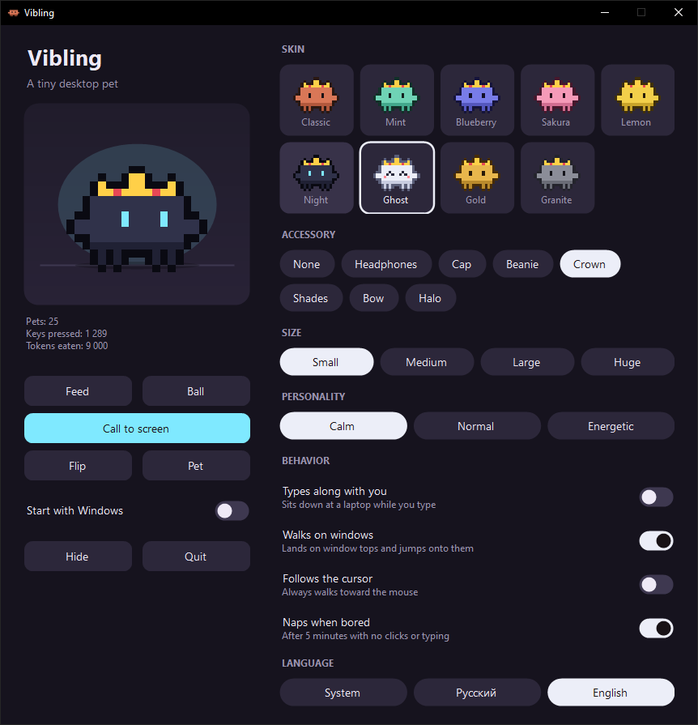
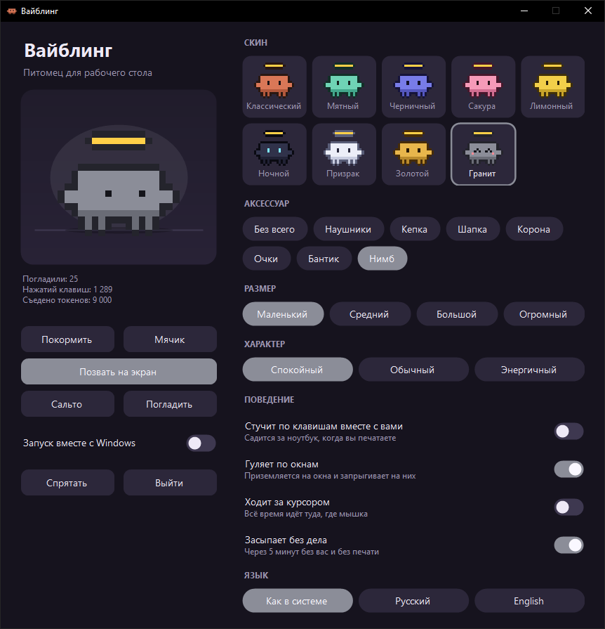

# Vibling

**A tiny pixel pet that lives on your Windows desktop.** It walks along the taskbar, climbs onto your windows, plays ball, sits down at a laptop when you type, and naps when you leave it alone.

[Русская версия ниже](#вайблинг)



## Features

- **Lives on your windows.** Drop it on a window's title bar and it lands there. Move the window and it rides along. Minimize the window and it falls. It also jumps onto windows by itself and walks along them.
- **Throw it around.** Grab it with the mouse and fling it. It bounces off screen edges and lands softly, hard, flat as a pancake, or sliding. Sometimes it opens a little umbrella.
- **Types along with you.** While you type, it sits down at a laptop and taps the keys, like Bongo Cat. It only counts key presses: keys are never recorded or sent anywhere.
- **Plays ball.** Throw the ball and it chases it, even onto windows and out of corners.
- **Has a life of its own.** It looks around, stretches, sits, dances, waves when your cursor comes close, and falls asleep when bored.
- **9 skins and 8 accessories:** headphones, cap, beanie, crown, shades, bow, halo.
- **4 sizes, 3 personalities, English and Russian.**

## Controls

| Action | What happens |
| --- | --- |
| Click | Pet it |
| Double-click | Flip |
| Drag and release | Carry and throw |
| Right-click / tray icon | Menu: feed, ball, sleep, settings, hide, quit |
| Click the tray icon | Open settings |

## Install

**Requirements:** Windows 10 or 11 and the [.NET Desktop Runtime 7 or newer](https://dotnet.microsoft.com/download/dotnet).

1. Download `Vibling.exe` from [Releases](../../releases) and run it.
2. Or build it yourself with the [.NET SDK 7+](https://dotnet.microsoft.com/download):

   ```powershell
   git clone https://github.com/KoarWinder/vibling.git
   cd vibling
   powershell -ExecutionPolicy Bypass -File .\install.ps1
   ```

   `install.ps1` builds the app, installs it to `%LOCALAPPDATA%\Programs\Vibling` and adds Desktop and Start menu shortcuts.

To build without installing:

```powershell
dotnet publish -c Release -r win-x64 --self-contained false -p:PublishSingleFile=true -o out
```

Windows SmartScreen may warn about an unsigned app on first launch. Click **More info → Run anyway**.

Settings and stats are stored in `%APPDATA%\Vibling\settings.json`.

## Project layout

| File | What's inside |
| --- | --- |
| `Program.cs` | Startup, single instance, window detection, settings, autostart |
| `Pet.cs` | The pet's behavior, physics and the ball |
| `Sprite.cs` | Pixel-art character, skins and accessories |
| `SettingsForm.cs` | Settings window |
| `Strings.cs` | English and Russian texts |

## License

[MIT](LICENSE). Vibling is a fan project and is not affiliated with Anthropic.

---

# Вайблинг

**Маленький пиксельный питомец, который живёт на рабочем столе Windows.** Гуляет по панели задач, забирается на окна, играет в мячик, садится за ноутбук, когда вы печатаете, и засыпает, если им не заниматься.



## Что умеет

- **Живёт на окнах.** Бросьте его на верхнюю полоску окна, и он туда приземлится. Двигаете окно — едет вместе с ним. Сворачиваете — падает. Сам запрыгивает на окна и гуляет по ним.
- **Его можно кидать.** Схватите мышкой и швырните: отскакивает от краёв экрана и приземляется по-разному — мягко, жёстко, «блинчиком» или проскальзывая. Иногда раскрывает зонтик.
- **Печатает вместе с вами.** Пока вы печатаете, садится за ноутбук и стучит по клавишам, как Bongo Cat. Он только считает нажатия: сами клавиши нигде не сохраняются и никуда не отправляются.
- **Играет в мячик.** Киньте мяч, и он побежит за ним, даже на окна и в углы экрана.
- **Живёт своей жизнью.** Оглядывается, потягивается, сидит, танцует, машет, когда подводите курсор, и засыпает от скуки.
- **9 скинов и 8 аксессуаров:** наушники, кепка, шапка, корона, очки, бантик, нимб.
- **4 размера, 3 характера, русский и английский язык.**

## Управление

| Действие | Что происходит |
| --- | --- |
| Клик | Погладить |
| Двойной клик | Сальто |
| Схватить и отпустить | Перенести и бросить |
| Правый клик / иконка в трее | Меню: покормить, мячик, спать, настройки, спрятать, выход |
| Клик по иконке в трее | Открыть настройки |

## Установка

**Нужно:** Windows 10 или 11 и [.NET Desktop Runtime 7 или новее](https://dotnet.microsoft.com/download/dotnet).

1. Скачайте `Vibling.exe` из [Releases](../../releases) и запустите.
2. Или соберите сами, нужен [.NET SDK 7+](https://dotnet.microsoft.com/download):

   ```powershell
   git clone https://github.com/KoarWinder/vibling.git
   cd vibling
   powershell -ExecutionPolicy Bypass -File .\install.ps1
   ```

   `install.ps1` собирает приложение, ставит его в `%LOCALAPPDATA%\Programs\Vibling` и создаёт ярлыки на рабочем столе и в «Пуске».

При первом запуске Windows SmartScreen может предупредить о неподписанном приложении. Нажмите **Подробнее → Выполнить в любом случае**.

Настройки и статистика хранятся в `%APPDATA%\Vibling\settings.json`.

## Лицензия

[MIT](LICENSE). Вайблинг — фанатский проект, он не связан с Anthropic.
