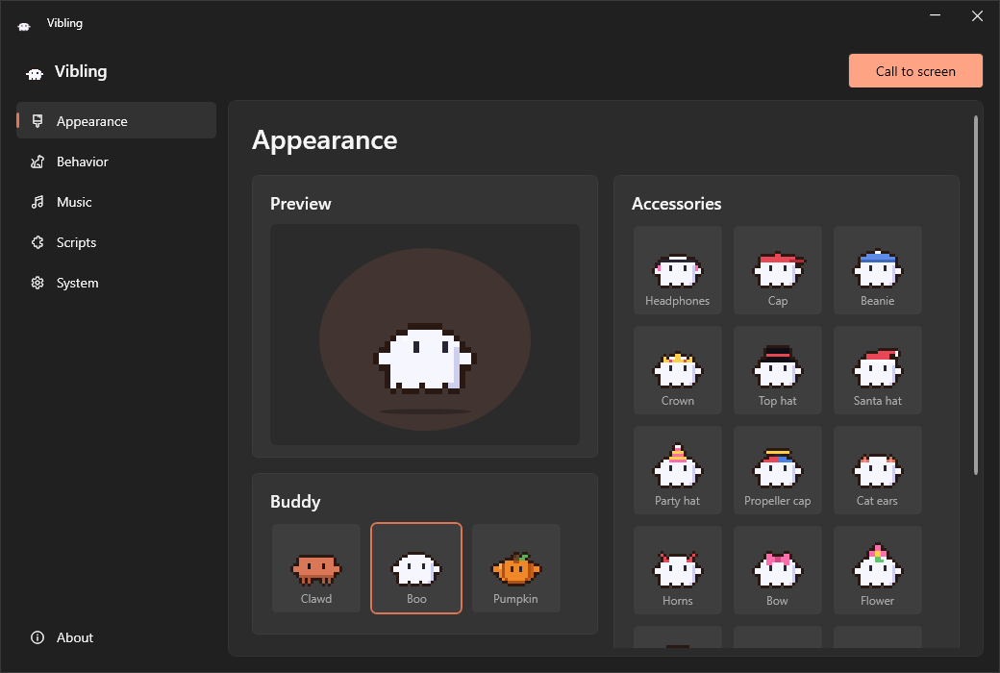
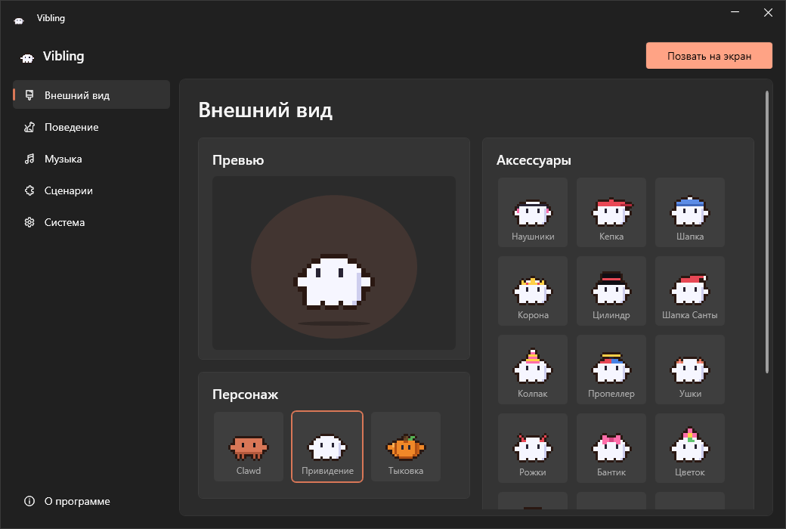

# Vibling

A tiny pixel pet for your Windows desktop. It walks along the taskbar, climbs onto windows, plays ball, sits down at a laptop while you type and naps when bored.

[Русская версия ниже](#vibling-по-русски)



## Features

- Lands on window title bars, rides along when you move a window, jumps between windows.
- Can be grabbed and thrown: bounces off screen edges, lands in different ways, sometimes opens an umbrella.
- Taps a laptop while you type. Key presses are only counted, never recorded.
- Chases a ball you can throw around.
- 3 buddies: Clawd, a floating ghost and a hopping pumpkin.
- 9 skins plus your own colors for body, eyes and outline.
- 17 accessories, wear as many as you like at once.
- Hides behind windows and the screen edge, peeks out and waves.
- Has moods: gets angry if you throw or poke him too much, gives you a flower when he's happy, sometimes farts and gets embarrassed.
- Zero gravity: floats, tumbles, dances and bounces off screen edges.
- Lo-fi generator with 6 styles. Every track is new, it can play while you're away, and Vibling vibes to it.
- Dances to the music playing on your speakers.
- Scripts: build behavior from blocks like in Scratch, with repeat and if.
- Hides in fullscreen apps (games, videos, F11) or keeps walking at the bottom of the screen.
- 4 sizes, 3 personalities, English and Russian.

## Controls

| Action | Result |
| --- | --- |
| Click | Pet |
| Double-click | Flip |
| Drag and release | Throw |
| Right-click / tray icon | Menu |

## Install

Download `Vibling.exe` from [Releases](../../releases) and run it. Requires Windows 10/11 and [.NET Desktop Runtime 7+](https://dotnet.microsoft.com/download/dotnet).

On every start Vibling asks GitHub whether a newer release is out and offers to update. This is the only network request it makes.

Build from source:

```
dotnet publish -c Release -r win-x64 --self-contained false -p:PublishSingleFile=true -o out
```

## License

[MIT](LICENSE)

---

# Vibling по-русски

Маленький пиксельный питомец для рабочего стола Windows. Гуляет по панели задач, забирается на окна, играет в мячик, садится за ноутбук, пока вы печатаете, и засыпает от скуки.



## Возможности

- Приземляется на верхнюю полоску окон, едет вместе с окном, прыгает с окна на окно.
- Его можно схватить и бросить: отскакивает от краёв экрана, приземляется по-разному, иногда раскрывает зонтик.
- Стучит по ноутбуку, пока вы печатаете. Нажатия только считаются, сами клавиши не сохраняются.
- Бегает за мячиком.
- 3 персонажа: Clawd, летающее привидение и прыгучая тыковка.
- 9 скинов и свой цвет: тело, глаза и обводка.
- 17 аксессуаров, можно надевать сколько угодно сразу.
- Прячется за окнами и краем экрана, выглядывает и машет.
- У него бывает настроение: злится, если часто бросать или тыкать, дарит цветочек, когда ему хорошо, иногда пукает и стесняется.
- Невесомость: летает, кувыркается, танцует и отскакивает от краёв экрана.
- Генератор лоу-фая с 6 стилями. Каждый трек новый, может играть, пока вас нет, а Vibling кайфует под него.
- Танцует под музыку из ваших колонок.
- Сценарии: поведение собирается из блоков, как в Scratch, с повторами и условиями.
- Прячется в полноэкранных приложениях (игры, видео, F11) или ходит по низу экрана.
- 4 размера, 3 характера, русский и английский язык.

## Управление

| Действие | Результат |
| --- | --- |
| Клик | Погладить |
| Двойной клик | Сальто |
| Схватить и отпустить | Бросить |
| Правый клик / иконка в трее | Меню |

## Установка

Скачайте `Vibling.exe` из [Releases](../../releases) и запустите. Нужны Windows 10/11 и [.NET Desktop Runtime 7+](https://dotnet.microsoft.com/download/dotnet).

При каждом запуске Vibling спрашивает у GitHub, не вышла ли новая версия, и предлагает обновиться. Больше программа никуда не обращается.

## Лицензия

[MIT](LICENSE)
